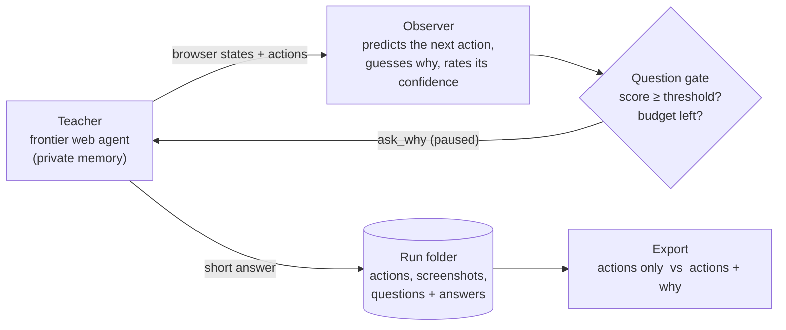

# ask-why

**Learning from Work by Asking Why: Selective Questions for Web Agents** (CS329Z project)

Watching someone work shows *what* they did, not *why*. This project tests whether an agent learns more from a work
demonstration if an observer is allowed to interrupt a few times and ask the worker why they did something.

This repository contains the data-collection system:



- **Teacher**: a frontier model (default Claude Opus 4.7 via OpenRouter) completes a [WorkArena++](https://github.com/ServiceNow/WorkArena) L3 task in a real ServiceNow browser, one action at a time. It keeps its own private notes; they never enter the training data.
- **Observer**: a separate, cheaper model that sees only the screen and the actions. Before each action it predicts what the teacher will do; afterwards it writes its best guess of why, with a confidence.
- **Question gate**: scores each decision on surprise, uncertainty, ambiguity, novelty, criticality and redundancy, and spends a small question budget (2–3 per task) where the score crosses a paced threshold.
- **ask_why**: the teacher is paused and answers from its own memory in four short fields (goal, evidence, alternatives, when it would act differently), then continues.
- **Export**: each successful run becomes two matched training sets: actions only, and actions plus the explanations.

### Status (midway report)

| Part | State |
|---|---|
| Teacher, observer, question gate, ask_why, recording, live panel | implemented, runs end to end |
| Paired export (action-only / rationale-enriched) | implemented |
| Baselines: random questions, no questions; question-budget option | implemented |
| LoRA training of student models and held-out evaluation | **not implemented yet** (final report) |

## Quickstart

Tested on macOS (Apple silicon) with Python 3.12; Linux should work but is untested. You need about 2 GB of disk and two accounts: [OpenRouter](https://openrouter.ai) (pays for the models, about $1–2 per teacher run) and [Hugging Face](https://huggingface.co) (free; gives access to the ServiceNow instances).

**1. Request access to the WorkArena instances** (do this first: approval can take a while).
Open <https://huggingface.co/datasets/ServiceNow/WorkArena-Instances>, fill in the form and accept the terms.

**2. Install.** [uv](https://docs.astral.sh/uv/getting-started/installation/) is recommended (it downloads Python 3.12 for you); without uv you need Python 3.12 installed.

```bash
git clone https://github.com/ranab123/ask-why.git
cd ask-why
./setup.sh
source .venv/bin/activate
```

`setup.sh` creates `.venv`, installs the package and its dependencies, installs Playwright's Chromium, and creates `.env`.

**3. Add your keys.**

```bash
# put your OpenRouter key (https://openrouter.ai/keys) in .env:
#   OPENROUTER_API_KEY=sk-or-...
hf auth login          # paste a Hugging Face token from https://huggingface.co/settings/tokens
```

**4. Check the setup** (spends no tokens):

```bash
python scripts/check_setup.py
```

It verifies the OpenRouter key, the Hugging Face login, access to the instance pool, and that the ServiceNow instances respond. Fix whatever it reports before going on.

**5. Run the agent.**

```bash
python -m askwhy run --panel
```

This runs the full method on `basic-expense-management-medium-l3`: Opus 4.7 as teacher, the scored question gate, a budget of 2 questions. Expect:

- **Setup wait**: WorkArena first creates the task's records on the instance. The browser sits on a blank page for anywhere from under a minute to 15+ minutes. The terminal prints `env ready` when the agent starts.
- **Windows**: the ServiceNow browser, BrowserGym's small chat window, and (with `--panel`) the Ask-Why panel showing every step, the observer's guess, the score bars and each question with its answer.
- **Duration and cost**: about 3 minutes and $1–2 once the agent starts (60 steps at most).
- **Result**: the terminal prints `✅ SUCCESS` or `❌ not solved` (WorkArena's own validator decides) and the run folder.

To stop a run press Ctrl-C (a few times if it is still in the setup wait).

## What a run produces

Everything goes to `runs/<run_id>/` (git-ignored):

| File | Contents |
|---|---|
| `run.json` | configuration, ticket text, models, result (solved or not, steps, questions, cost) |
| `steps.jsonl` | one line per step: the action, the observer's prediction / guess / confidence (`observer`), the gate's scores and decision (`selector`), the outcome |
| `questions.jsonl` | each question and the teacher's four-field answer |
| `obs/step_NNN.png`, `obs/step_NNN.txt` | screenshot and accessibility tree the agents saw at each step |
| `llm_calls.jsonl` | tokens, cost and latency per model call |
| `teacher_private.jsonl` | the teacher's private notes, kept for auditing whether its answers match its reasoning. Never shown to the observer and never exported. Disable with `--no-save-teacher-memory`. |
| `screen.mov` | full-screen recording (macOS, with `--panel`; `--no-record` to skip) |

Example from a solved run. The observer expected the teacher to open one expense record; the teacher selected a different one, and the gate asked:

> **Q (step 8):** Why this record / choice rather than click on 'Open record: EXP-01272359394'?
> **Evidence:** Four expenses share 'Attorney poor movie again.'; only EXP-01272359394 is linked to Change Request CHG0032440, so per protocol the task-linked one is kept and the others deleted.

The observer's own guess for the same step was "selecting the expense line record to perform a bulk action". The policy rule only appears in the answer.

## Reproducing the midway report

The midway report contains no student-training results yet. What it reports, and how to reproduce each item:

| Reported | Command | What you should see |
|---|---|---|
| Gate and export unit tests | `pytest` | 11 tests pass (no browser, keys or network needed) |
| Pipeline test with WorkArena's scripted solver | `python -m askwhy run --mode oracle` | the scripted solver completes the task in 9 sub-steps; the observer and gate run on top and ask up to 2 questions; cost about $0.02 |
| A teacher demonstration with questions | `python -m askwhy run --panel` | the teacher works through the ticket; up to 2 questions asked and answered. Our reference run: solved in 17 steps, 2 questions, $1.21 |
| Paired export | `python -m askwhy.export runs/<run_id>` | `export/action_only.jsonl` and `export/rationale.jsonl`, one line per step, identical actions |

Runs are not deterministic: the models are sampled, and L3 tasks are hard, so a teacher run can fail (it is then marked not solved and is not exported). `--mode oracle` replaces the teacher with WorkArena's built-in solver so the rest of the pipeline can be tested cheaply. It is a development aid, not part of the method, and the export refuses its runs.

### Collecting data for the experiment

The four task templates and the conditions from the report:

```bash
# tasks
#   basic-expense-management-medium-l3        date-based-expense-management-medium-l3
#   amount-based-expense-management-medium-l3 priority-assignment-medium-l3

python -m askwhy run --task priority-assignment-medium-l3 --seed 101   # selective questions (default budget: 2 expense, 3 priority)
python -m askwhy run --selector random                                  # baseline: same budget, random decision points
python -m askwhy run --selector none                                    # baseline: no questions
python -m askwhy run -b 4                                               # budget sweep: -b 1, -b 2, -b 4

python -m askwhy.export runs/*/                                         # successful teacher runs → paired training data
```

Seeds 0–9 are reserved for held-out evaluation and are refused for collection runs (`--allow-eval-seeds` overrides). Without `--seed`, each task uses its WorkArena++ curriculum seed. Run one episode at a time per ServiceNow instance.

Training the two LoRA students on the exported data and evaluating them on the held-out seeds is the remaining work for the final report.

## How the gate decides

At each *decision point* (a new activity segment, a state-changing action, or an action the observer did not predict):

```
g = 0.25·S + 0.20·U + 0.15·A + 0.10·N + 0.30·C − 0.25·R        ask if g ≥ τ and budget remains
τ = clip(0.55 + 0.25·(1 − ρ), 0.25, 0.85)      ρ = (questions left / decisions left) ÷ (budget / expected decisions)
```

| Signal | Source | Meaning |
|---|---|---|
| S surprise | observer, before the action | the teacher's action was not among the observer's predictions (or had low probability) |
| U uncertainty | observer, after the action | 1 − the observer's confidence in its own explanation |
| A ambiguity | observer, after the action | how many other explanations the observer finds plausible |
| N novelty | rule | first time this kind of action occurs on this kind of page, or a new segment |
| C criticality | rule + observer hint | consequential or hard-to-undo actions (delete, save, close) score high |
| R redundancy | rule | a similar step was already asked about, or a question was asked very recently |

The threshold τ rises after a question is spent and falls when the budget is going unused, so questions are spread over the demonstration. Weights and threshold settings are in `askwhy/config.py`.

## Useful options

`python -m askwhy run --help` lists everything. The common ones:

| Option | Default | Purpose |
|---|---|---|
| `--task` | `basic-expense-management-medium-l3` | L3 task (`python -m askwhy tasks` lists all) |
| `--selector` | `scored` | `scored` (the gate), `random`, `none` |
| `-b`, `--budget` | 2 (expense), 3 (priority) | number of questions |
| `--teacher-model`, `--observer-model` | `anthropic/claude-opus-4.7`, `google/gemini-3.1-flash-lite` | any OpenRouter model id; both must accept images unless `--no-vision` |
| `--panel` | off | live panel window (also turns on screen recording on macOS) |
| `--headless` | off | no browser window, for machines without a display |
| `--max-steps` | 60 | cap on teacher steps (and on cost) |
| `--mode oracle` | | scripted solver in place of the teacher (development aid) |
| `--answerer human` | | experimental and untested: you type the answer in the chat window in place of the teacher |

Other tools: `python scripts/play_l3.py <task>` opens a task for you to try by hand and grades it; `python scripts/check_setup.py --pin` fixes one ServiceNow instance in `.env` so every run uses the same one.

## Repository layout

```
askwhy/
  runner.py         main loop and command line
  teacher.py        the teacher agent: private memory, acting, answering ask_why
  observer.py       the observer: blind prediction, then interpretation with confidence
  selector/         the question gate (scored.py), baselines (random_sel.py, none_sel.py), segmentation
  explainer.py      question templates and answerers
  export.py         paired training-data export
  recorder.py       run folder writer        recording.py   screen recording (macOS)
  oracle.py         scripted-solver mode     env_factory.py BrowserGym/WorkArena helpers
  llm.py            OpenRouter client        config.py      all settings and defaults
  panel/            the live Ask-Why panel   prompts/       every prompt used
scripts/            check_setup.py, play_l3.py
tests/              gate pacing, action parsing, export
```

## Troubleshooting

- **`Could not access ServiceNow/WorkArena-Instances`**: your Hugging Face access request is not approved yet, or you are not logged in (`hf auth login`).
- **The browser stays blank for many minutes**: that is WorkArena's setup, not a hang. Wait for `env ready`.
- **`OPENROUTER_API_KEY is not set`**: put the key in `.env` in the repository root.
- **The teacher keeps failing or returns nothing**: some models reject the browser-agent prompt through OpenRouter (Claude Sonnet 5.5 returned empty, content-filtered replies for us). The run stops after 3 failed replies; choose another `--teacher-model`.
- **"Aw, Snap!" in the browser**: Chromium crashed on the page. Press Enter in the terminal and run again.
- **No `screen.mov`**: macOS only. Allow your terminal app under System Settings → Privacy & Security → Screen Recording, then rerun. `--record-browser` saves a browser-only video on any system.
- **A step blocks for more than 3 minutes**: the run writes `hang_traces.txt` to the run folder showing where it is stuck.

## Data and credentials

`.env` (your OpenRouter key and, if pinned, instance credentials) and `runs/` are git-ignored. Run folders contain ServiceNow instance URLs from the gated WorkArena pool, so do not publish them without removing those. The ServiceNow instances are shared research instances provided by the WorkArena team under their terms.

## References

- Drouin et al., *WorkArena: How Capable Are Web Agents at Solving Common Knowledge Work Tasks?*, ICML 2024
- Boisvert et al., *WorkArena++: Towards Compositional Planning and Reasoning-based Common Knowledge Work Tasks*, 2024
- Jiang et al., *Inducing Task Models from Computer-Use Traces*, 2026 (segmentation into activities and goals)
- Wang et al., *TaskNet: Building Occupational Task Inventories from Worker Interviews at Scale*, 2026 (follow-up questions)
- Hoque et al., *ThriftyDAgger: Budget-Aware Novelty and Risk Gating for Interactive Imitation Learning*, 2022 (budgeted asking)
- Hu et al., *LoRA: Low-Rank Adaptation of Large Language Models*, ICLR 2022 (planned student training)

Code in this repository was written with the help of Claude Code, as disclosed in the report.
